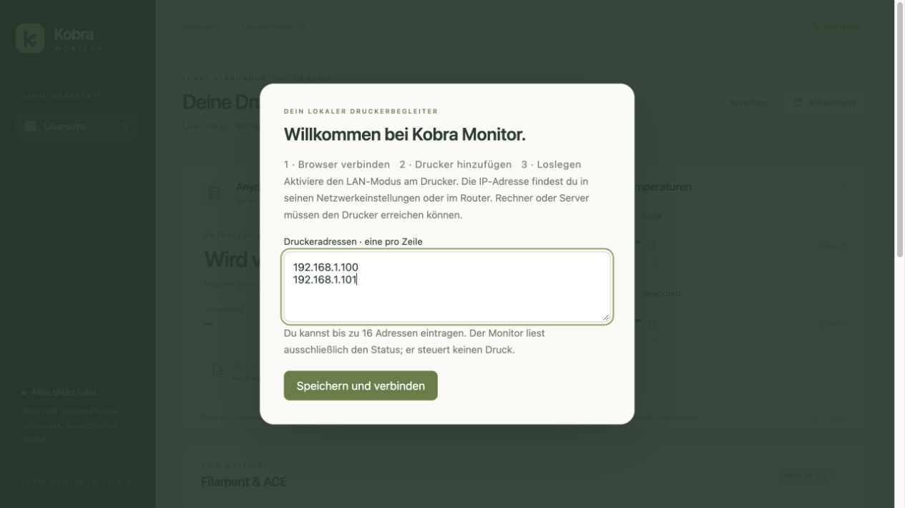

# Kobra Monitor

Eine lokale, standardmäßig lesende Übersicht für den **Anycubic Kobra S1 mit
Stock-Firmware und LAN-Modus**. Status, Temperaturen, ACE-Filamente, Druckhistorie,
Berichte und Temperaturkurven bleiben bei dir. Keine Anycubic-Cloud-Anmeldung.

Optional ist das Kammerlicht ausgewählter S1-Drucker direkt auf der Übersicht schaltbar. Ein Klick schaltet das Licht ohne zusätzliche Bestätigung; neue Druckerrückmeldungen bestätigen den tatsächlichen Zustand. [Freigabe und Grenzen](docs/LIGHT_CONTROL.md).

Optional lassen sich Bauteil-, Zusatz- und Kammerlüfter über „Einstellen“ mit Stufenauswahl und OK-Bestätigung steuern. [Freigabe und Grenzen](docs/FAN_CONTROL.md).

Optional ist der Speed Mode während eines laufenden Drucks über einen Auswahl- und OK-Dialog einstellbar. [Freigabe und Grenzen](docs/SPEED_CONTROL.md).

**Entwicklungsstand: 0.25.0-alpha.1.** Der Monitor ersetzt zunächst die Überwachungsfunktionen
der Cloud. Druckstart, Upload, Pause, Stop, Heizung, Bewegung und
Filamentsteuerung sind nicht enthalten. Ein vollständiger Kobra-S1-Druck und
zwei parallele Druckerverbindungen wurden auf macOS beobachtet. Auch auf einem
UGREEN DXP4800GT mit UGOS läuft der amd64-Container mit zwei Druckern;
Einrichtung und aktive Verlaufseinträge blieben beim Containerneustart erhalten.



## Auf einem Rechner starten

Voraussetzung: Python **3.11 oder neuer**; zur Erstinstallation Internetzugriff auf
PyPI. Der Python-Installer für Windows sollte den Python Launcher mit installieren.

1. Projekt herunterladen und vollständig entpacken.
2. Den passenden Starter öffnen:
   - macOS: `Start-Kobra-Monitor.command`
   - Windows: `Start-Kobra-Monitor.cmd`
   - Linux: `sh Start-Kobra-Monitor.sh`
3. Der Browser öffnet die lokale Oberfläche. Beim ersten Start deinen Benutzernamen und dein Passwort festlegen; später mit diesem Konto anmelden.
4. Im Assistenten pro Drucker eine IP-Adresse eingeben. Weitere Geräte mit **Drucker hinzufügen** ergänzen und **Speichern und verbinden** wählen. Der Assistent zeigt den Verbindungsstand pro Gerät.
5. Unter **Einrichten** lassen sich die Adressen später ändern.

Die Adresse findest du am Drucker oder im Router. Aktiviere LAN-Modus. Es findet
kein Netzwerkscan statt. Maximal 16 Adressen können eingerichtet werden;
praktisch getestet wurden zwei Drucker.

Das Terminalfenster geöffnet lassen; **Ctrl+C** beendet nur den Monitor. Der
Rechner muss für die Überwachung eingeschaltet und wach bleiben. Browser schließen
beendet den Dienst nicht. Bei einer erneuten Installation im selben Ordner bleiben
Druckhistorie und Einrichtung erhalten. Die Starter aktualisieren ihre Bibliotheken,
wenn sich die festgelegten Versionen ändern.

macOS kann beim ersten Start einer heruntergeladenen `.command`-Datei eine
Freigabe verlangen. Die Datei über die Systemeinstellungen bzw. das Kontextmenü
nach Prüfung freigeben; das Paket ist nicht signiert oder notarisiert.

## Auf Server oder NAS installieren

Für UGREEN DXP4800GT mit UGOS gibt es eine [eigene Anleitung](docs/UGREEN_UGOS.md).

Für einen dauerhaft eingeschalteten Linux-Server oder ein NAS mit Docker/Compose
ist das eigene [Docker-Paket](docs/INSTALLATION.md) vorgesehen. NAS ohne
Container-Unterstützung sind kein zugesagtes Installationsziel.

```sh
docker compose up -d --build
```

Standardmäßig ist die Oberfläche nur auf dem Server selbst erreichbar. Historie,
Druckerzuordnung und dein lokales Benutzerkonto liegen im Volume `monitor-data`.
Beim ersten Start legst du Benutzername und Passwort selbst fest. Auf dem Rechner
führt der Starter direkt dorthin. Auf einem NAS öffnest du einmalig den privaten
Einrichtungslink; danach meldest du dich auf allen Geräten mit deinem Konto an.
[Schritte für Einrichtung und Kontowiederherstellung](docs/INSTALLATION.md#benutzerkonto).

Der amd64-Container wurde in der CI gebaut und auf UGREEN DXP4800GT mit UGOS
praktisch geprüft. Weitere NAS-Modelle und ARM64 stehen noch aus.

## Daten sichern

Ein separater Sicherungsdienst kann auf dem NAS täglich sieben vollständige
Datenstände aufbewahren. Die laufende Überwachung bleibt dabei unverändert.
[Sicherung, Zugangsdaten und Wiederherstellung](docs/BACKUPS.md).

## Von unterwegs zugreifen

Der Monitor läuft bei den Druckern zu Hause. Handy oder Laptop greifen über das
vorhandene VPN auf ihn zu. Es gibt keinen vorgeschriebenen VPN-Anbieter.

- **Tailscale:** Tailscale auf dem Monitor-Host und dem Mobilgerät; Tailscale Serve
  stellt `http://127.0.0.1:7125` privat im Tailnet als HTTPS bereit.
- **Klassisches VPN:** WireGuard, OpenVPN oder Router-VPN verbinden ins Heimnetz.
  Der Monitor bzw. sein HTTPS-Proxy wird gezielt an eine erreichbare private
  Serveradresse gebunden.

[Anleitung und Grenzen des Fernzugriffs](docs/REMOTE_ACCESS.md).
Kein Portforwarding aus dem öffentlichen Internet auf den Monitor.

Für die ersten Schritte im Browser: [Kurzanleitung für den Alltag](docs/BEDIENUNG.md).

## Drucker anordnen

Ziehe eine Druckerkarte auf die gewünschte Position. Auf Touchgeräten nutzt du
den Punktgriff links. Alternativ die Karte mit Tab fokussieren und mit
Alt + Pfeiltasten verschieben. Die Reihenfolge wird auf dem Monitor gespeichert
und gilt auf allen Geräten. Die Auswahl und laufende Druckerverbindungen bleiben
beim Umsortieren erhalten. Dies ändert keine Druckereinstellung.

## Was du siehst

- Unabhängige Status- und Verbindungsanzeige pro Drucker; veraltete Werte sind markiert.
- Druckdatei, Fortschritt, Layer, verbleibende Zeit und Ist-/Solltemperaturen.
- ACE-Slots, Material, Farben und gemeldete Restmengen.
- Kameraansicht des ausgewählten Druckers auf Wunsch, ungefähr zwei Bilder pro Sekunde.
- Dauerhafte, nach Dateiname und Status durchsuchbare Druckhistorie.
- Herunterladbare Markdown-Berichte und Temperaturkurven mit Zustandsereignissen.

Restprozente, Feuchtigkeit und Firmware-Zeitangaben sind nicht unabhängig
validiert. Nullwerte bedeuten nicht zuverlässig leere Spulen oder echte 0 % Feuchte.
Ein bestätigter Druckabschluss ist kein visueller Qualitätsnachweis des Bauteils.
Verbindungsverlust bedeutet niemals automatisch Druckende.

## Kamera ansehen

Wähle einen Drucker und öffne **Kamera anzeigen**. Die Bilder kommen über dieselbe
angemeldete Oberfläche, auch über HTTPS und VPN. Es gibt keine Kamera-Aufzeichnung.
Mit **Ansicht schließen**, beim Druckerwechsel oder beim Verlassen des Tabs endet
die Ansicht; ungenutzte Leserverbindungen werden nach kurzer Nachlaufzeit beendet.

Das NAS-Paket enthält FFmpeg. Bei nativer Installation muss aktuelles FFmpeg im
Suchpfad liegen. Der Monitor liest nur den bereits verfügbaren lokalen Kamerastream.
Er aktiviert oder deaktiviert die Kamera am Drucker nicht. Ist der Stream dort
nicht verfügbar, erscheint eine verständliche Meldung. [Einzelheiten und Grenzen](docs/CAMERA.md).

## Zugang und Daten

Du legst ein lokales Besitzerkonto mit Benutzername und Passwort an. Das Passwort
wird mit scrypt und einem zufälligen Salt als Prüfwert gespeichert. Passwortmanager
werden unterstützt. Unter **Konto** kannst du Zugangsdaten ändern; **Abmelden**
beendet deine Browsersitzung. Der alte Zugangscode ist nach der Umstellung gesperrt.
Sitzungen laufen nach zwölf Stunden ab und werden beim Dienstneustart ungültig.
Es gibt derzeit ein gemeinsames Konto pro Installation, keine getrennten Rollen.

Datenordner: `.state/` im Projekt, im Container `/data`. Für andere Orte:
`--data-dir /pfad` oder `KOBRA_DATA_DIR`. Einzelheiten, Sicherung und Update:
[Installation](docs/INSTALLATION.md). Die `.state`-Dateien gehören nicht ins Repository.

**Wichtige Grenze:** Die übernommene TLS-Serverprüfung zum Drucker ist deaktiviert.
Die Verbindung ist verschlüsselt, die Identität des Brokers aber nicht verifiziert.
Nur in einem vertrauenswürdigen Druckernetz betreiben. [Sicherheitsbeschreibung](SECURITY.md).

## Entwicklung und Tests

```sh
python -m venv .venv
# macOS/Linux:
.venv/bin/python -m pip install -r requirements-lock.txt
.venv/bin/python -m unittest discover -s tests -v
.venv/bin/python vendor/kobra-bridge/test_read_only.py
node --check static/monitor.js
node --check static/setup.js
node tests/test_timeline_render.js
node tests/test_archive_render.js
python scripts/release_check.py
```

Unter Windows liegt Python unter `.venv\Scripts\python.exe`. Die CI prüft
Python 3.11 und 3.14 auf macOS, Linux und Windows. Alle sechs Plattformläufe
und der Container-Test bestanden am 30.10.2026. Die CI arbeitet ohne reale
Drucker; Hardware- und Fernzugriffstests sind gesondert ausgewiesen.
[Testmatrix und belegter CI-Lauf](docs/VALIDATION.md).

## Herkunft und Lizenz

Gesamtprojekt: **GPL-3.0-only**. Die ursprünglichen Lizenzen und Hinweise der
mitgelieferten Bibliotheken bleiben erhalten. Verwendet werden:

- `cluzl/kobra-bridge`, Basis `25c36815f5e2cab394fc83c73fca447367253fca`, GPL-3.0;
  lokale Lesebeschränkung und getrennte Zertifikatspfade.
- `rvanderp3/kobra-connect`, Basis `3edba24606d7122c4a68accd09af937ba4fdbd08`, Apache-2.0;
  nur Kernmodule und Handshake, mit einer TLS-Parameterkorrektur.

[NOTICE](NOTICE.md), [SOURCES.json](SOURCES.json), [Änderungen an Fremdcode](docs/UPSTREAM.md).
Keine Slicer-Zertifikate oder privaten Schlüssel werden ausgeliefert. Anycubic
und Tailscale sind Marken ihrer jeweiligen Rechteinhaber; dies ist ein unabhängiges Projekt.

### Kameraübersicht

Unter Kamera die Ansicht **Kameraübersicht** wählen, zwei oder vier Bilder pro Seite einstellen und **Kameras anzeigen** öffnen. Bei mehr Druckern mit Zurück/Weiter blättern. Auf dem Handy stehen die Bilder untereinander. Nur die sichtbare Seite wird geladen; maximal vier verschiedene Kameras gleichzeitig auf dem Monitorserver, auch über mehrere Browser hinweg. Gleiche Kameras teilen sich einen Decoder.

Optionale Meldungen auf iPhone, Android und unterstützten Desktop-Browsern: [Einrichtung und Grenzen](docs/NOTIFICATIONS.md). Erst nach Aktivierung je Gerät; verschlüsselte Zustellung über den Browser-Push-Dienst.

## Betriebsstatus und Hilfe

Unter **Betriebsstatus → Öffnen** prüfst du Verbindungsfrische, Kameraaufbereitung, Verlauf und Benachrichtigungsdienst. Hinweise auf diesem Gerät erklären unter anderem gesperrte Benachrichtigungen. **Prüfbericht kopieren** enthält begrenzte technische Ergebnisse ohne IP-Adressen, Namen, Zugangsdaten oder Push-Schlüssel. [Einzelheiten](docs/DIAGNOSTICS.md).

## Mehrere Drucker vergleichen

Jede Druckerkarte zeigt Druckstatus, Fortschritt, geschätzte Restzeit sowie Düse und Druckbett. Eine Karte auswählen öffnet die vertrauten Details darunter. Karten bleiben per Ziehen oder Tastatur sortierbar. Fortschritt und Restzeit erscheinen nur bei aktuellen Druck-/Pausendaten; während der Vorbereitung werden möglicherweise zwischengespeicherte Werte ausgeblendet. Veraltete Druckdaten und Temperaturen werden getrennt behandelt. Bei Verbindungsverlust werden die Livewerte in der Karte ausgeblendet.

Der größere Projektplan steht in [ROADMAP.md](ROADMAP.md). Einrichtung der optionalen Spulenverwaltung: [Spoolman-Anbindung](docs/SPOOLMAN.md). Noch keine automatische Verbrauchsbuchung oder NFC-Zuordnung.

## Kundenaufträge und Berichte

Navigation mit getrennten Arbeitsbereichen, optionale Kundenauftragsnummern und manuelle Qualitätsabnahme, feste Berichtsversionen sowie PDF-/JSON-/Markdown- und ZIP-Export: [Bedienung und Archivgrenzen](docs/CUSTOMER_REPORTS.md). Keine Druckersteuerung oder automatische Verbrauchsbuchung.

Die originale Spoolman-Oberfläche kann ab 0.20 geschützt unter **Spulen → Spulen verwalten** eingebettet werden. [Einrichtung und Updates](docs/SPOOLMAN_EMBEDDED.md). Manuelle Änderungen schreiben in Spoolman; die Drucker bleiben lesend.
